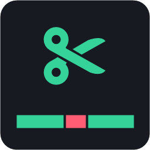

<h1 align="center">คัทชน ✂</h1>

  ตัดช่วงเงียบ · ตัดคำพูดผิด · ต่อคลิปชนกัน 
  แอปตัดคลิปพูดสำหรับคนทำ YouTube / TikTok บน Windows

  <a href="https://github.com/xAomSK/katchon/releases/latest"><b>⬇ ดาวน์โหลดเวอร์ชันล่าสุด</b></a>

---

อัดคลิปพูดจาก OBS มาแล้วลากใส่คัทชน แอปจะตัดช่วงเงียบ เสียงหายใจ และจุดที่พูดผิดให้เอง ต่อหลายคลิปเป็นไฟล์เดียว ใส่ซับไทย แล้วส่งออกเป็นไฟล์พร้อมลง YouTube หรือ TikTok

## ทำอะไรได้บ้าง

**ตัดให้อัตโนมัติ**
- ตัด **ช่วงเงียบ** และ **เสียงหายใจ** ระหว่างประโยค ปรับได้ว่าจะตัดแบบนุ่ม ปกติ หรือรัว
- ถอดคำพูดเป็น **ข้อความภาษาไทย** ด้วย Whisper ที่รันในเครื่อง แล้วไฮไลต์จุดที่ **พูดผิด พูดซ้ำ หรือคำเติม** (อ่า เอ่อ อืม) ให้ตัดจากข้อความได้เลย
- ต่อ **หลายคลิปชนกัน** เป็นไฟล์เดียว และเตือนเมื่อเจอ **เทคที่อัดพลาด** แล้วอัดใหม่

**ทำให้พร้อมลง**
- **ซับไทยอัตโนมัติ** แบบ TikTok (คำที่กำลังพูดเป็นสีเหลือง) หรือแบบ YouTube พร้อมไฟล์ `.srt` แก้คำผิดได้
- ส่งออกเป็น **YouTube 16:9** หรือ **TikTok / Shorts 9:16** (ครอปตามคน หรือภาพเต็มกับพื้นหลังเบลอ)
- **เสียงพากย์ใส** (ลดเสียงรบกวน ลดเสียง ส/ซ เกลี่ยเสียง) และปรับความดังเป็นมาตรฐาน −14 LUFS
- **ซูมสลับตรงรอยต่อ** ช่วยกลบรอยตัด
- **ปี๊บคำหยาบ** ให้เอง (แก้รายการคำได้)
- **✨ ทำ Shorts** จากคลิปยาว: หาช่วงเด็ด แล้วส่งออกเป็นคลิปแนวตั้งพร้อมซับและหัวข้อ
- **Chapters** สำหรับคำอธิบายคลิป YouTube

**ใช้กับโปรแกรมอื่น**
- ส่งไทม์ไลน์ที่ตัดแล้วไปตัดต่อต่อใน **Premiere Pro** หรือ **DaVinci Resolve** ได้ โดยไม่ต้องเรนเดอร์
- **OBS อัดเสร็จแล้วเด้งถาม** ว่าจะเอาคลิปเข้าโปรแกรมไหม
- **อัปเดตตัวเอง** เมื่อมีเวอร์ชันใหม่

## ติดตั้ง

1. ไปที่ [หน้าดาวน์โหลด](https://github.com/xAomSK/katchon/releases/latest) แล้วกดไฟล์ **`JumpCut-Setup-x.y.z.exe`** (ในหัวข้อ Assets)
2. ดับเบิลคลิกไฟล์ที่โหลดมา แอปจะติดตั้งให้เองโดยไม่ต้องใช้สิทธิ์แอดมิน แล้วมีไอคอน **คัทชน** บนเดสก์ท็อป
3. ถ้า Windows ขึ้น **“Windows protected your PC”** ให้กด **More info → Run anyway** (แอปยังไม่ได้เซ็นชื่อดิจิทัล)

- ffmpeg ติดมากับแอปแล้ว ไม่ต้องลงเพิ่ม
- เมื่อมีเวอร์ชันใหม่ แอปจะโหลดให้เองเบื้องหลัง แล้วติดตั้งตอนปิดโปรแกรม (หรือกดปุ่ม **⬆ อัปเดต** ด้านบนเพื่อรีสตาร์ทเลย)

## เริ่มใช้

1. **ลากไฟล์วิดีโอ** มาวางในหน้าต่าง (ลากหลายไฟล์พร้อมกันได้ แอปเรียงตามเวลาที่อัดให้)
2. แอปตัดช่วงเงียบให้ทันที บนไทม์ไลน์ **สีเขียว = เก็บไว้**, **สีแดง = ตัดออก** ถ้าตัดเยอะหรือน้อยไป ให้เลือก **นุ่ม / ปกติ / รัว** ทางขวา
3. กด **📝 ถอดคำพูด** ครั้งแรกแอปจะชวนติดตั้งส่วนถอดคำพูด (โหลดครั้งเดียว 3–5 GB) จากนั้นจุดที่น่าจะพูดผิดจะขึ้นเป็นไฮไลต์สีส้ม
4. กด **F** ไล่ดูทีละจุด ถ้าใช่ก็กด **X** เพื่อตัด
5. กด **ส่งออก** แล้วเลือกรูปแบบ **YouTube** หรือ **TikTok / Shorts**

แอปบันทึกงานเองตลอด ปิดแล้วเปิดใหม่ก็ทำต่อได้ ไฟล์ต้นฉบับไม่ถูกแก้ไข แอปสร้างไฟล์ใหม่ทุกครั้ง

### คีย์ลัดที่ใช้บ่อย

| ปุ่ม | ทำอะไร |
|---|---|
| Space | เล่น / หยุด |
| ลากบนไทม์ไลน์ | เลือกช่วง |
| X | ตัดช่วงที่เลือก |
| R | เก็บช่วงที่เลือก |
| F | ไปจุดที่น่าจะพูดผิดถัดไป |
| ↓ / ↑ | ฟังรอยต่อถัดไป / ก่อนหน้า |
| B | ปี๊บ / เลิกปี๊บ |
| V | ดูกรอบแนวตั้ง 9:16 |
| ดับเบิลคลิกคำ | แก้คำในซับ |
| Ctrl+Z | ย้อน |

คีย์ลัดใช้ได้แม้คีย์บอร์ดเป็นภาษาไทยอยู่

## เครื่องที่ใช้ได้

- Windows 10 หรือ 11 แบบ 64-bit
- การ์ดจอ NVIDIA ไม่บังคับ แต่ถ้ามี จะเรนเดอร์และถอดคำพูดเร็วขึ้นมาก (ไม่มีก็ใช้ CPU ได้ แค่ช้ากว่า)
- พื้นที่ว่าง: ตัวแอปประมาณ 850 MB และถ้าติดตั้งส่วนถอดคำพูด ใช้อีก 3.4–5.5 GB
- ใช้อินเทอร์เน็ตแค่ตอนติดตั้งส่วนถอดคำพูด ตอนอัปเดต และตอนใช้ AI (ถ้าเปิดใช้)

## ความเป็นส่วนตัว

- การตัด ถอดคำพูด และเรนเดอร์ ทำในเครื่องทั้งหมด วิดีโอไม่ถูกส่งไปไหน
- ฟีเจอร์ AI (ไม่บังคับ) ใช้ตอนตั้งชื่อ Chapters และเลือกช่วงทำ Shorts เท่านั้น ต้องใส่ API key ของ Claude เอง และจะส่งไปแค่ข้อความที่ถอดได้ ไม่ส่งวิดีโอหรือเสียง

## ถามบ่อย

**ไม่มีการ์ดจอ NVIDIA ใช้ได้ไหม?**
ได้ครบทุกอย่าง แต่การถอดคำพูดจะช้ากว่ามาก (คลิป 1 นาทีใช้ราว 3–5 นาที)

**Premiere ขึ้น File Import Failure**
ย้ายไฟล์ `.xml` ไปไว้ในโฟลเดอร์ที่ชื่อไม่มีอีโมจิ (เช่น 🔴) แล้ว Import ใหม่

**ถอนการติดตั้ง**
Settings → Apps → **คัทชน** · งานที่ทำค้างไว้และไฟล์ที่แอปโหลดมาเก็บอยู่ที่ `%APPDATA%\jumpcut-app` ลบโฟลเดอร์นี้ทิ้งได้ถ้าไม่ใช้แล้ว

**เจอปัญหา**
แจ้งได้ที่ [Issues](https://github.com/xAomSK/katchon/issues) บอกเวอร์ชัน (ดูได้ที่ ⚙ ตั้งค่า → อัปเดต) และแนบภาพหน้าจอมาด้วยจะช่วยได้มาก

---

คัทชนมี [ffmpeg](https://ffmpeg.org) (สัญญาอนุญาต GPL) อยู่ข้างใน และใช้ [faster-whisper](https://github.com/SYSTRAN/faster-whisper) กับโมเดล Whisper large-v3 สำหรับถอดคำพูด
